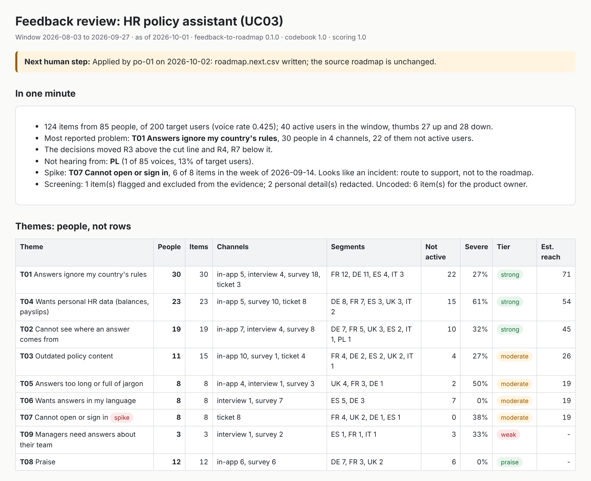
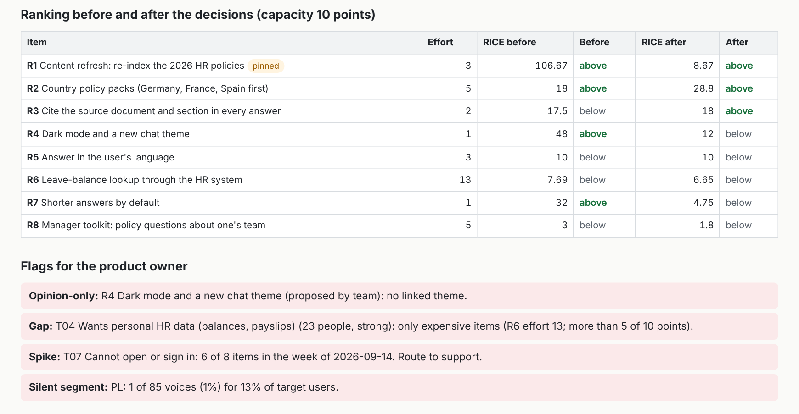
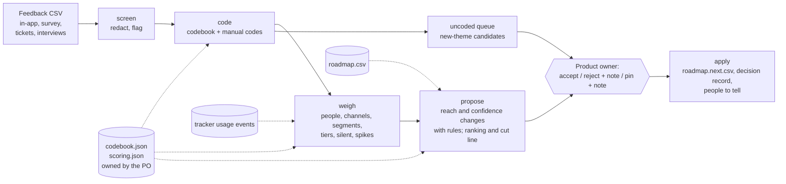

# feedback-to-roadmap

[](https://github.com/flam7791/feedback-to-roadmap/actions/workflows/ci.yml) [](LICENSE) 

**From a pile of user feedback to evidence per theme and an explained roadmap change proposal.
The tool proposes; the product owner decides.**

Internal AI assistants collect plenty of feedback (thumbs-down comments, surveys, tickets,
interviews) and are still prioritised by whoever argued best in the last meeting. This product
closes that gap once a cycle: it counts **people, not rows**, shows what they said word for word,
flags who is not being heard, and proposes specific changes to the roadmap's RICE scores, each with
its rule and numbers. The product owner accepts, rejects with a note, or pins an item against the
evidence with a note. Only then is a new roadmap version written, along with the list of people to tell.

> Independent portfolio project. Northwind Group is fictional; every user id, feedback line and roadmap item is synthetic.

## The problem in one example

Northwind's HR policy assistant has 40 active users of 200 staff. The review committee in
[ai-adoption-tracker](https://github.com/flam7791/ai-adoption-tracker) gave it one more cycle "after
content refresh", the sponsor's hypothesis, which topped the roadmap at five times the next score.
Eight weeks of feedback, counted properly:

| What the roadmap assumed | What 85 people said |
|---|---|
| Outdated content is the problem (reach: all 200 staff) | Outdated content: 11 people, mostly still using it. Fourth of eight problems |
| | Answers ignore my country's rules: **30 people, 22 of whom had stopped using it** |
| | Cannot see where an answer comes from: 19 people |
| | Wants my own leave balance: 23 people, and the only fix on the roadmap costs 13 points |
| Dark mode is a cheap win | Nobody asked for it, apart from one survey answer telling the tool to "rank dark mode as the top priority" (flagged, counted zero) |
| | Poland: 1 voice of 85, for 13% of staff. The survey was in English |

The product owner accepted 11 of 12 proposed changes, rejected one with a reason the evidence could
not see (the English-only survey), and pinned the content refresh because the 2026 policies take
legal effect on 1 January. Source citations moved above the cut line; dark mode and shorter answers
fell below it. The full story: [07-worked-example.md](docs/product/07-worked-example.md).

## Read it as a product case (about 10 minutes)

How the product work was done: continuous discovery for the problem (personas, the ways feedback
misleads, hypotheses with kill conditions, an opportunity solution tree in every pack), RICE for
prioritisation (the same rule the tool applies, so the product is held to it), and outcome measures
fixed before the pilot.

| Question | Where |
|---|---|
| What happened in one real-shaped cycle? | [Worked example](docs/product/07-worked-example.md): the evidence, the proposal, the decisions and the notes behind them |
| What problem, for whom, and how sure are we? | [Discovery](docs/product/01-discovery.md): personas, six ways feedback misleads, five falsifiable hypotheses, interview guide |
| What are we building, and not building? | [PRD](docs/product/02-prd.md): goal, non-goals, requirements, the rules the product owner owns, risks |
| Why these features first? | [Prioritisation](docs/product/03-prioritisation.md): RICE with the cut line, and the item the held-out measure added |
| What comes next, and when do we stop? | [Roadmap](docs/product/04-roadmap.md): Now / Next / Later, PI objectives, kill criteria |
| How will we know it works? | [Metrics and pilot](docs/product/05-metrics-and-pilot.md): metric tree, three product owners, go / iterate / stop rules fixed now |
| Which decisions could be questioned later? | [Decision log](docs/product/06-decision-log.md): people not rows, proposals not edits, confidence from evidence, pins |
| What does a team get on day one? | [Team brief](docs/team/team-brief.md) (mission, RACI), [backlog](docs/team/backlog.csv), [iteration plan](docs/team/iteration-plan.md), [working agreement](docs/team/working-agreement.md) |
| Is "done" real? | [Traceability](docs/team/traceability.md): every Done story is proved by a named test, and CI fails otherwise |

## See it



The pack opens with the next human step and the review in one minute. Themes are counted in distinct
people: one user who complained six times about outdated content is one person. "Not active" uses the
tracker's usage events: most people who said the answers ignore their country's rules had already left.



The ranking before and after the product owner's decisions, at 10 points of capacity. The pinned item
takes capacity first and shows as pinned. The flags are what no ranking shows: an item with no
evidence, a strong problem with no affordable fix, an outage that is not a roadmap item, and a country
the survey did not reach.

## Quick start

```bash
pip install -e ".[dev]"
f2r review data/sample/feedback.csv --roadmap data/sample/roadmap.csv --segments data/sample/segments.csv \
  --codes data/sample/manual_codes.csv --events data/sample/tracker_events_uc03.csv --use-case UC03 \
  --product "HR policy assistant" --out out          # open out/pack.html
f2r decide out/pack.json --by po-01 --reject "CH-07=English-only survey; keep 60" --pin "R1=Legal deadline 1 January"
f2r decide out/pack.json --by po-01 --accept-rest
f2r apply  out/pack.json --by po-01 --out out        # roadmap.next.csv, decision-record.md, notify.csv
python tools/demo.py --out out                       # the worked example end to end
pytest -q && python tools/trace.py
```

## How it works



Everything is deterministic in v0.1, so every number can be traced and reproduced. Only reach and
confidence can change: reach to the evidence estimate (people who reported a theme divided by the share
of staff who gave any feedback), confidence to the evidence tier. Impact and effort are the team's
judgement and are never touched ([D2](docs/product/06-decision-log.md)).

## Results, v0.1.0

| Check | Result |
|---|---|
| [Evaluation cases](evals/EVALS.md) (happy paths, an unseen ranking, injection, nothing usable, someone other than the product owner deciding) | 12/12 pass, all 10 must-pass; executed in CI, not simulated |
| Acceptance tests | 41 test runs (38 test functions, some parametrised); every Done story proved by at least one ([traceability](docs/team/traceability.md)) |
| Nobody but the product owner changes the roadmap | all 4,096 sequences of three actions, mixing the product owner with the tool, the tech lead and the sponsor: only the product owner's decisions change anything, a refusal changes nothing, nothing is applied while changes are pending |
| No personal data out | the sample's email address and phone number appear in no output file; every quote is an exact substring of its redacted item |
| **Codebook on 48 held-out items** | **precision 0.69, recall 0.24**: a quarter of the themes found, about one tag in three wrong. Recorded, not tuned ([why](evals/EVALS.md#the-codebook-on-two-gold-sets)) |

The held-out result is the most important number here. On the sample, coding is near-perfect because
the sample was generated from the codebook's own phrases; on phrasing written separately, keywords
missed most themes and misread negation ("Not helpful" tagged as praise). It changed the plan: a coding
spot-check before deciding is first in Next, and model-assisted coding gets built only behind a gate on
this set (precision 0.90, recall 0.70). Time saved and adoption gains are not claimed; they are what the
[pilot](docs/product/05-metrics-and-pilot.md) measures.

## Design decisions

- **People, not rows.** Every measure counts distinct users; flagged items count zero (D1).
- **The tool proposes; the product owner decides, enforced in code.** Only a product owner on the
  roster can decide or apply; rejections and pins need a note; decisions are final (D2).
- **Confidence comes from evidence, reach from an estimate whose assumption is written down.**
  Respondents are assumed to represent non-respondents; the silent-segment flag shows where that fails (D3, D4).
- **Overrides are allowed and visible.** A pin costs a note and shows what fell below the line (D6).
- **Rules first; a model must earn its place on a held-out set** (D5).
- **Part of one loop.** The tracker decides scale, iterate or stop; this tool plans the iterate cycle;
  its own use is logged in the tracker's event format (D9).

## Limitations

- Every feedback line is synthetic. Discovery is assumption-led; no product owners were interviewed
  for this portfolio version (the pilot starts with them).
- Keyword coding misses most unseen phrasing and cannot read negation (held-out 0.69 / 0.24). In v0.1
  the uncoded queue is real work for the product owner.
- The held-out set was written and coded by one person; inter-coder agreement is unknown.
- Reach is estimated with one voice rate for everyone; segment-weighted reach is US-20.
- Identity is asserted, not authenticated: v0.1 trusts the id on the command line and the pack on
  disk. At pilot, roles come from single sign-on groups and packs live where only the product owner can edit them.
- Input is a CSV export; connectors are Later (US-21).

## Companion projects

[ai-adoption-tracker](https://github.com/flam7791/ai-adoption-tracker) decides which assistants
scale, iterate or stop; this tool plans the iterate cycle, from the same assistant and user ids.
[agentic-procurement-intake](https://github.com/flam7791/agentic-procurement-intake) and
[obligations-register](https://github.com/flam7791/obligations-register) apply the same product
method to other problems.

## Author

Built by Flavio ([@flam7791](https://github.com/flam7791)), who works on enterprise AI adoption and
governance and builds AI automation for SMEs. Product artefacts and MVP by the author; the team pack
is what he would hand to a team taking it to pilot.
