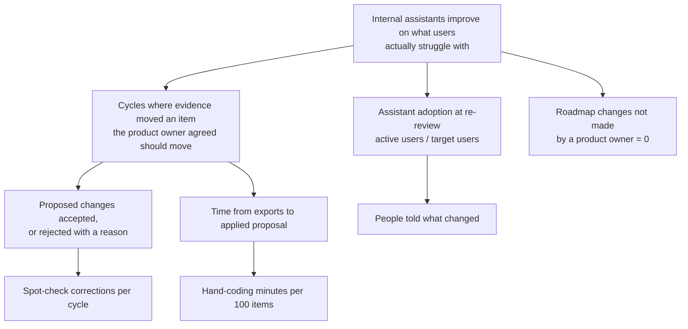

# 5. Metrics and the pilot

Status: v0.1, October 2026. Owner: product owner. Every target is fixed **before** the pilot starts,
so the go / iterate / stop call cannot be argued after the fact.

## 5.1 Metric tree

| Level | Metric | Definition | Source |
|---|---|---|---|
| Outcome (the assistant's) | Adoption | Active users in the window / target users, at the committee re-review | ai-adoption-tracker |
| Outcome (this tool's) | Evidence moved the plan | Cycles where an item crossed the cut line and the product owner agreed / cycles | Decision record + a one-line product owner note |
| Leading | Acceptance | Accepted changes / proposed changes; rejections classified (obligation, biased channel, disagreement) | pack.json |
| Leading | Time to decision | Minutes from exports to `f2r apply` | Product owner's log |
| Leading | Coding cost | Minutes spent on the uncoded queue per 100 items | Product owner's log |
| Guardrail | Unauthorised changes | Roadmap versions without a product owner's apply | pack.json; CI sequence test |
| Guardrail | Personal data in outputs | Any email, phone or employee number in pack, record or notify list | CI test; DPO spot check |

## 5.2 Pilot design

- **Who:** three product owners from the portfolio in ai-adoption-tracker: the HR policy assistant
  (UC03, the committee's "one more cycle"), customer email drafting (UC01) and the code review helper
  (UC08). Different users, channels and adoption levels.
- **Duration:** three review cycles each (about three months).
- **Comparison:** each product owner's last cycle before the pilot, reconstructed: what was planned,
  from what evidence, how long it took. Weaker than a parallel control; stated as such. A parallel
  control is not possible with three product owners.
- **Weekly touchpoint:** 20 minutes with each product owner: what surprised you, what did you not
  trust, what did you code by hand.

## 5.3 Decision rules (fixed now)

| Result after three cycles | Decision |
|---|---|
| H2 and H3 hold, coding under 30 minutes per 100 items | **Go**: offer to every assistant in the portfolio; build connectors (US-21) |
| H2 and H3 hold, coding 30 to 60 minutes | **Iterate**: model-assisted coding must pass its gate before widening |
| H2 fails (pack shows nothing new in two of three cycles) | **Stop**: the problem was not the evidence; return to discovery |
| Any guardrail breach | **Stop** until the cause is fixed and a test added |

H5 (adoption of the HR assistant) is reported, not used for the go / no-go: the assistant's adoption
depends on what the team builds, not only on how it chose.

## 5.4 What we will not claim

Hours saved, adoption gains or acceptance rates are not claimed for v0.1; they are what the pilot
measures. The numbers in the worked example are from synthetic data and show the mechanics only.
